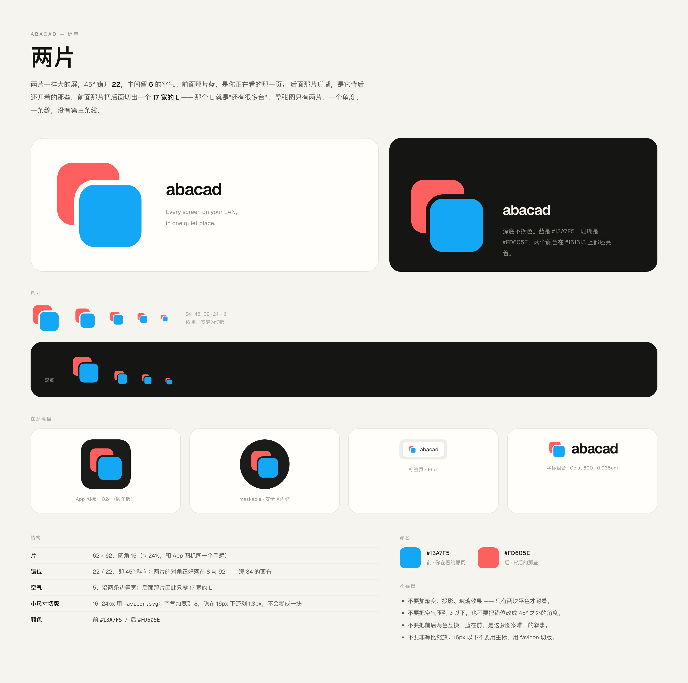

# abacad · 标志「两片」

两片一样大的屏，45° 错开 22，中间留 5 的空气。前面那片蓝是你正在看的那一页，后面那片珊瑚是它背后还开着的那些 —— 前面那片把后面切出一个 17 宽的 L，那个 L 就是"还有很多台"。



（`brand.html` 是这张图的源文件，浏览器打开即可。）

## 文件

```
brand/
├── mark.svg                    主标（≥ 24px 都用它）
├── favicon.svg                 16–24px 切版：空气 8，缝在 16px 下还剩 1.3px
├── icons/
│   ├── favicon-16.png          ← <link rel="icon">
│   ├── favicon-32.png
│   ├── apple-touch-icon-180.png
│   ├── icon-512.png            PWA
│   ├── icon-1024.png           macOS / iOS 源图（满幅方图，系统自己切圆角）
│   ├── icon-rounded-1024.png   网页 / 文档用（22.5% 圆角）
│   └── icon-maskable-1024.png  PWA maskable，图形收在 80% 安全圆内
├── lockup@2x.png / @3x.png     字标组合（透明底，Geist 600，字距 −0.035em）
├── brand.png / brand.html      这张规范图
├── app-header.png              标志在登录页头部的实拍（内联组件）
└── archive/                    前三版提案（round / v2 / 03），留档
```

## 结构

| | |
|---|---|
| 片 | 62 × 62，圆角 15（≈24%，和 App 图标同一个手感） |
| 错位 | 22 / 22，45° 斜向；两片对角正好落在 8 与 92 —— 满 84 的画布 |
| 空气 | 5，沿两条边等宽，后面那片因此只露 17 宽的 L |
| 颜色 | 前 `#13A7F5` ／ 后 `#FD605E` |
| 对称 | 形状 180° 点对称；颜色前后不同，是这张图唯一的叙事 |

两个约束别动：

- **空气 5 是几何不是审美。** 错位 22 减去空气 5 = 17，就是那个 L 的宽度；空气一变，L 就不成立了（压到 3 以下，L 会胖成第二块方砖）。
- **16px 必须换切版。** 主标的 5 单位在 16px 下只有 0.8px，会糊成一块；`favicon.svg` 把空气加到 8，缝还剩 1.3px。

## 安装

已接进站点：`frontend/public/favicon.svg`（16px 切版）＋ rail 与登录页头部的内联标志
（`frontend/src/components/brand-mark.tsx`，同一份几何，不用 ``，不占请求）。

位图那几枚**还没接线**：服务器只显式路由了 `/favicon.svg`，根目录下的 PNG 会 404。要接上，在
`internal/web/server.go` 的 favicon handler 旁边加三条即可：

```go
for _, f := range []string{"favicon-32.png", "favicon-16.png", "apple-touch-icon.png"} {
    name := f
    mux.HandleFunc("GET /"+name, func(w http.ResponseWriter, r *http.Request) {
        b, err := fs.ReadFile(distFS, name)
        if err != nil {
            http.NotFound(w, r)
            return
        }
        w.Header().Set("Content-Type", "image/png")
        w.Header().Set("Cache-Control", "public, max-age=86400")
        _, _ = w.Write(b)
    })
}
```

配套：`frontend/public/` 放这三枚 PNG，`index.html` 加 `<link rel="icon" sizes="32x32" …>` 与
`<link rel="apple-touch-icon" …>`；PWA 再用 `icon-512.png` + `icon-maskable-1024.png` 填 manifest。

## 不要做

- 不要加渐变、投影、玻璃效果。只有两块平色才耐看。
- 不要把空气压到 3 以下，也不要把错位改成 45° 之外的角度。
- 不要把前后两色互换：蓝在前，是这套图案唯一的叙事。
- 不要非等比缩放；16px 以下不要用主标，用切版。

## 归档

- `archive/round/` 01 版：环窗 / 方窗 / 开口（圆环家族）
- `archive/v2/` 02 版：屏 / A 字 / 门
- `archive/03/` 03 版：接 / 叠（三片）/ 缝 —— 现在这套是从"叠"收成两片来的
